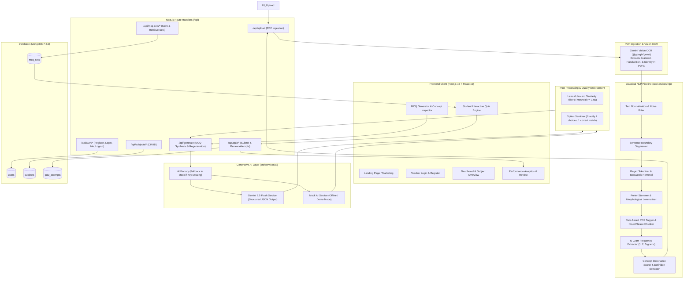
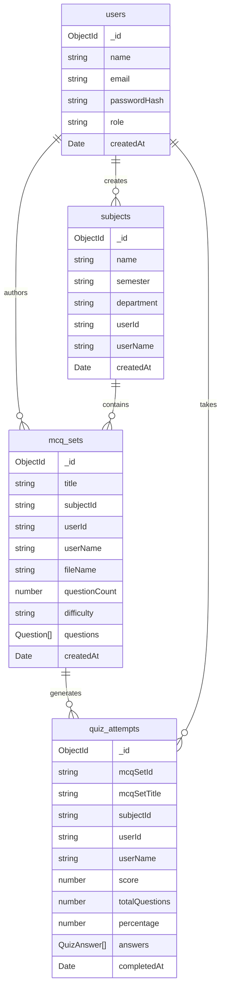

# 📚 ExamEase — Complete Project Documentation (A to Z Guide)

> **ExamEase** is an end-to-end, academic-grade **Natural Language Processing (NLP) & Artificial Intelligence powered examination platform**. It ingests raw lecture notes, textbooks, and PDF documents, extracts core conceptual knowledge using a multi-stage deterministic NLP pipeline, and synthesizes syllabus-grounded, verified Multiple Choice Questions (MCQs) for automated assessment, live test-taking, and scoring analytics.

---

## 📑 Table of Contents

1. [Executive Summary & Problem Statement](#1-executive-summary--problem-statement)
2. [High-Level Architecture & Workflow](#2-high-level-architecture--workflow)
3. [Technology Stack](#3-technology-stack)
4. [Complete Directory & Codebase Structure](#4-complete-directory--codebase-structure)
5. [Deep-Dive: Classical NLP Pipeline](#5-deep-dive-classical-nlp-pipeline)
   - [5.1 Text Normalization & Noise Cleaning](#51-text-normalization--noise-cleaning)
   - [5.2 Sentence Boundary Segmentation](#52-sentence-boundary-segmentation)
   - [5.3 Tokenization & Stopwords Filtering](#53-tokenization--stopwords-filtering)
   - [5.4 Stemming & Morphological Lemmatization](#54-stemming--morphological-lemmatization)
   - [5.5 Part-of-Speech (POS) Tagging & Noun Phrase Chunking](#55-part-of-speech-pos-tagging--noun-phrase-chunking)
   - [5.6 N-gram Extraction (Unigram, Bigram, Trigram)](#56-n-gram-extraction-unigram-bigram-trigram)
   - [5.7 Concept Extraction & Definition Scoring](#57-concept-extraction--definition-scoring)
   - [5.8 Duplicate Question Detection via Jaccard Similarity](#58-duplicate-question-detection-via-jaccard-similarity)
6. [Deep-Dive: AI Generation & Gemini Vision OCR](#6-deep-dive-ai-generation--gemini-vision-ocr)
   - [6.1 Universal PDF Extraction (Gemini Vision OCR)](#61-universal-pdf-extraction-gemini-vision-ocr)
   - [6.2 Strict Grounded Prompt Engineering](#62-strict-grounded-prompt-engineering)
   - [6.3 Dual-Provider Architecture (Gemini 2.5 Flash + Mock AIService)](#63-dual-provider-architecture-gemini-25-flash--mock-aiservice)
   - [6.4 Question Validation & Structural Sanitization](#64-question-validation--structural-sanitization)
   - [6.5 In-Line Regeneration of Individual Questions](#65-in-line-regeneration-of-individual-questions)
7. [Core Application Features & Modules](#7-core-application-features--modules)
   - [7.1 Teacher Authentication & Session Security](#71-teacher-authentication--session-security)
   - [7.2 Subject & Curriculum Management](#72-subject--curriculum-management)
   - [7.3 Interactive MCQ Generator UI & Concept Inspector](#73-interactive-mcq-generator-ui--concept-inspector)
   - [7.4 Interactive Test-Taking Engine](#74-interactive-test-taking-engine)
   - [7.5 Automated Scoring, Detailed Results & Analytics](#75-automated-scoring-detailed-results--analytics)
   - [7.6 Shareable Test Links for Public Students](#76-shareable-test-links-for-public-students)
8. [Database Architecture & Data Models](#8-database-architecture--data-models)
9. [REST API Reference](#9-rest-api-reference)
10. [Configuration & Environment Variables](#10-configuration--environment-variables)
11. [Installation, Setup & Run Instructions](#11-installation-setup--run-instructions)
12. [Security, Performance & Best Practices](#12-security-performance--best-practices)
13. [Future Roadmap & Project Extensions](#13-future-roadmap--project-extensions)

---

## 1. Executive Summary & Problem Statement

### 1.1 The Challenge
Creating high-quality examination questions from academic literature and class notes is traditionally:
- **Time-Consuming**: Educators spend dozens of hours writing questions, distractors (wrong options), and explanations.
- **Prone to Hallucinations**: Standard Generative AI tools often fabricate facts, inject out-of-syllabus concepts, or craft trivial questions without understanding academic Bloom's taxonomy.
- **PDF Extraction Failures**: Scanned PDFs, multi-column research papers, handwritten notes, and documents with custom font encodings (`Identity-H`, CID fonts) break conventional parser libraries like `pdf-parse` or `pdf2json`.

### 1.2 The ExamEase Solution
ExamEase introduces a **hybrid two-stage architecture**:
1. **Deterministic Classical NLP Pre-Processing**: Before sending any prompt to an LLM, the uploaded document is segmented, tokenized, lemmatized, POS-tagged, and scored for core concepts, key definitions, and n-gram frequencies.
2. **Strictly Grounded AI Generation**: The generative model (Google Gemini 2.5 Flash) receives **only** the scored academic concepts and supporting context sentences. It is constrained to generate questions grounded strictly in the source text.
3. **Automated Lexical Validation & De-Duplication**: Generated questions pass through a Jaccard token similarity filter to eliminate duplicate questions and ensure 4 balanced options, exactly one correct answer, and an explanatory citation.

---

## 2. High-Level Architecture & Workflow



---

## 3. Technology Stack

| Layer | Technology | Version | Purpose / Description |
| :--- | :--- | :--- | :--- |
| **Framework** | Next.js (App Router + Turbopack) | `16.3.5` | Server-side rendering, API route handlers, routing, static optimization |
| **UI Library** | React | `19.2.8` | Declarative component UI with modern hooks and React Compiler support |
| **Styling** | Tailwind CSS v4 + PostCSS | `^4.0.0` | Modern responsive styling, custom utility classes, glassmorphism UI |
| **Icons** | Lucide React | `^1.47.0` | Clean vector iconography throughout dashboard, quiz, and navigation |
| **Database** | MongoDB Native Driver | `^7.6.0` | High-throughput document store with connection pooling (`db.ts`) |
| **AI SDK** | Google GenAI SDK (`@google/genai`) | `^2.23.0` | Official client for Gemini 2.5 Flash and Gemini Vision multimodal models |
| **Security / Auth** | `jose` | `^6.2.12` | Cryptographic JWT signing and verification for stateless sessions |
| **Password Hash** | `bcryptjs` | `^3.0.3` | Salted one-way hashing for secure password persistence |
| **Type Safety** | TypeScript | `^5.0.0` | Strict type validation across models, API responses, and client props |
| **Compiler** | React Compiler (`babel-plugin-react-compiler`) | `1.0.0` | Automatic memoization of components and hooks |

---

## 4. Complete Directory & Codebase Structure

```text
ExamEase/
├── .env.example                  # Template for environment configuration
├── .gitignore                    # Git tracking ignore rules
├── AGENTS.md                     # Next.js agent operational rules
├── package.json                  # Project manifest, dependencies, and npm scripts
├── package-lock.json             # Pinned dependency lockfile
├── postcss.config.mjs            # PostCSS configuration for Tailwind CSS v4
├── next.config.ts                # Next.js configuration
├── tsconfig.json                 # TypeScript strict compiler configuration
├── eslint.config.mjs             # ESLint configuration
├── public/                       # Static public assets (favicons, graphics)
│   ├── favicon.ico
│   ├── file.svg
│   ├── globe.svg
│   └── window.svg
└── src/
    ├── types/
    │   └── index.ts              # Core TypeScript interfaces & domain entities
    ├── lib/
    │   ├── db.ts                 # MongoDB singleton client with connection pooling
    │   └── auth.ts               # Password hashing, JWT token creation & verification
    ├── services/
    │   ├── pdf.service.ts        # Gemini Vision OCR PDF parser
    │   ├── mcq.service.ts        # MCQ generation orchestrator, validation & deduplication
    │   ├── ai/
    │   │   ├── ai.interface.ts   # Common interface for generative AI services
    │   │   ├── ai.factory.ts     # Factory choosing GeminiAIService or MockAIService
    │   │   ├── gemini.service.ts # Google Gemini 2.5 Flash implementation
    │   │   └── mock.service.ts   # Deterministic offline mock AI service
    │   └── nlp/
    │       ├── nlpPipeline.ts    # Main NLP pipeline coordinator
    │       ├── tokenizer.ts      # Tokenizer, stopword removal & PDF noise filters
    │       ├── sentenceSegmenter.ts # Sentence boundary detection & clean-up
    │       ├── stemmerLemmatizer.ts # Porter stemmer & irregular English lemmatizer
    │       ├── posTagger.ts      # Rule-based Part-of-Speech tagger & noun phrase chunker
    │       ├── ngrams.ts         # Unigram, Bigram, and Trigram frequency extractors
    │       ├── conceptExtractor.ts # Concept scoring, definition patterns & heading bonuses
    │       └── duplicateDetector.ts # Jaccard similarity-based question deduplication
    ├── components/
    │   ├── layout/
    │   │   ├── Navbar.tsx        # Responsive navigation bar with auth session awareness
    │   │   └── Footer.tsx        # Application footer with links and attribution
    │   └── mcq/
    │       ├── MCQPreviewCard.tsx # Editable card for reviewing, editing & regenerating MCQs
    │       └── NLPConceptInspector.tsx # Visual tabbed inspector for tokens, POS, ngrams & concepts
    └── app/
        ├── layout.tsx            # Global HTML shell & font definitions
        ├── globals.css           # Global Tailwind CSS and animation definitions
        ├── page.tsx              # Public landing page showcasing features & workflow
        ├── (auth)/
        │   ├── login/page.tsx    # Teacher login form with validation & cookies
        │   └── register/page.tsx # Teacher registration form
        ├── (dashboard)/
        │   ├── dashboard/page.tsx # Central hub: recent tests, subjects, quick actions
        │   ├── subjects/page.tsx  # Subject management: create, view, and organize subjects
        │   ├── subjects/[id]/page.tsx # Subject detail view: tests belonging to subject
        │   ├── generate/page.tsx  # Flagship MCQ Generator (PDF upload, NLP inspect, AI prompt)
        │   ├── quiz/[id]/page.tsx # Interactive test-taking engine (timer, questions, submit)
        │   └── results/[id]/page.tsx # Comprehensive test results, score, & question breakdown
        └── api/
            ├── auth/
            │   ├── register/route.ts # POST: create new teacher user
            │   ├── login/route.ts    # POST: authenticate & issue HTTP-only JWT
            │   ├── logout/route.ts   # POST: clear auth cookies
            │   └── me/route.ts       # GET: fetch current authenticated user profile
            ├── subjects/
            │   ├── route.ts          # GET: list subjects, POST: create subject
            │   └── [id]/route.ts     # GET: subject details, DELETE: remove subject
            ├── upload/
            │   └── route.ts          # POST: multipart PDF upload, OCR text & run NLP pipeline
            ├── generate/
            │   └── route.ts          # POST: generate MCQs from NLP result, PUT: regenerate single MCQ
            ├── mcq-sets/
            │   ├── route.ts          # GET: list MCQ sets, POST: save validated MCQ set
            │   └── [id]/route.ts     # GET: retrieve MCQ set, DELETE: remove MCQ set
            └── quiz/
                ├── submit/route.ts   # POST: submit student answers & calculate score
                └── results/[id]/route.ts # GET: retrieve detailed quiz attempt results
```

---

## 5. Deep-Dive: Classical NLP Pipeline

Rather than throwing unformatted raw text directly into an LLM prompt, ExamEase executes a 7-stage deterministic NLP pipeline implemented in pure TypeScript (`src/services/nlp/`).

```mermaid
flowchart LR
    A["Raw PDF / Text"] --> B["1. Normalization & Noise Cleaning"]
    B --> C["2. Sentence Boundary Detection"]
    C --> D["3. Regex Tokenizer & Stopwords Filter"]
    D --> E["4. Morphological Lemmatizer & Porter Stemmer"]
    E --> F["5. POS Tagger & Noun Phrase Chunker"]
    F --> G["6. N-gram Extraction (1, 2, 3-grams)"]
    G --> H["7. Concept & Definition Scorer"]
    H --> I["Structured NLPAnalysisResult"]
```



### 5.1 Text Normalization & Noise Cleaning
- Strips carriage returns, multiple spaces, and control characters.
- Detects and filters out raw PDF binary stream artifacts (e.g. `obj`, `endobj`, `stream`, `flatedecode`, `cidfont`, `identity-h`, `adobe`).
- Enforces minimum document threshold (at least 50 readable characters) to prevent running on empty files.

### 5.2 Sentence Boundary Segmentation
Implemented in [sentenceSegmenter.ts](file:///c:/shubham%20dalvi%20project/ExamEase/src/services/nlp/sentenceSegmenter.ts):
- Identifies sentence endings via punctuation (`.`, `!`, `?`).
- Handles academic abbreviations (e.g., `Dr.`, `Prof.`, `e.g.`, `i.e.`, `Fig.`, `et al.`) to avoid premature splits.
- Cleans leading enumeration labels (e.g., `1.`, `(a)`, `i)`) and discards sentences shorter than 15 characters.

### 5.3 Tokenization & Stopwords Filtering
Implemented in [tokenizer.ts](file:///c:/shubham%20dalvi%20project/ExamEase/src/services/nlp/tokenizer.ts):
- Word boundaries, hyphenated technical terms (`client-server`, `state-of-the-art`), and alphanumeric strings are parsed via `\b[A-Za-z0-9]+(?:-[A-Za-z0-9]+)*\b`.
- Cross-checked against a 150+ English Stopwords Set (articles, pronouns, conjunctions, auxiliary verbs, and formatting noise).

### 5.4 Stemming & Morphological Lemmatization
Implemented in [stemmerLemmatizer.ts](file:///c:/shubham%20dalvi%20project/ExamEase/src/services/nlp/stemmerLemmatizer.ts):
- **Irregular Dictionary**: Accurately maps irregular academic plurals and verb inflections (e.g., `matrices` $\rightarrow$ `matrix`, `hypotheses` $\rightarrow$ `hypothesis`, `criteria` $\rightarrow$ `criterion`, `analyses` $\rightarrow$ `analysis`).
- **Rule-Based Porter Stemmer**: Strips common derivational and inflectional suffixes (`-sses`, `-ies`, `-ing`, `-ed`, `-ational`, `-tional`, `-ization`, `-fulness`).

### 5.5 Part-of-Speech (POS) Tagging & Noun Phrase Chunking
Implemented in [posTagger.ts](file:///c:/shubham%20dalvi%20project/ExamEase/src/services/nlp/posTagger.ts):
- Rule-based morphological POS tagger classifying tokens into `NN` (Noun), `JJ` (Adjective), `VB` (Verb), `RB` (Adverb), etc.
- **Noun Phrase Chunker**: Scans for contiguous patterns like `[Adjective]* + [Noun]+` (e.g., *"Distributed Operating System"*, *"Relational Database Management System"*).

### 5.6 N-gram Extraction (Unigram, Bigram, Trigram)
Implemented in [ngrams.ts](file:///c:/shubham%20dalvi%20project/ExamEase/src/services/nlp/ngrams.ts):
- Computes frequency-ranked single words (unigrams), two-word phrases (bigrams), and three-word phrases (trigrams).
- Discards combinations that begin or end with stopwords.

### 5.7 Concept Extraction & Definition Scoring
Implemented in [conceptExtractor.ts](file:///c:/shubham%20dalvi%20project/ExamEase/src/services/nlp/conceptExtractor.ts):
Detects explicit definitional statements using regex heuristics:
- `X is defined as Y`
- `X refers to / denotes / signifies Y`
- `Concept: X`
- `X : Y`

**Concept Importance Formula**:
$$\text{Importance Score} = \text{Term Frequency} \times 1.0 + \text{Definition Bonus} (4.0) + \text{Heading Bonus} (3.0) + \text{POS Bonus} (2.0)$$

Each extracted concept retains its supporting sentences to provide verified ground-truth context for AI prompting.

### 5.8 Duplicate Question Detection via Jaccard Similarity
Implemented in [duplicateDetector.ts](file:///c:/shubham%20dalvi%20project/ExamEase/src/services/nlp/duplicateDetector.ts):
To prevent repetitive questions generated for the same concept, each question is normalized into a lemmatized token set:
$$J(A, B) = \frac{|A \cap B|}{|A \cup B|}$$
- If $J(A, B) \ge 0.65$, question $B$ is detected as a near-duplicate and automatically replaced with an alternative candidate.

---

## 6. Deep-Dive: AI Generation & Gemini Vision OCR

### 6.1 Universal PDF Extraction (Gemini Vision OCR)
Most Node.js PDF extraction libraries fail when parsing:
- Scanned physical exam papers or photocopied handouts
- Handwritten lecture notes
- Documents encoded with non-standard font encodings (`Identity-H` or CID mapping tables)

ExamEase solves this in [pdf.service.ts](file:///c:/shubham%20dalvi%20project/ExamEase/src/services/pdf.service.ts) using **Gemini Vision OCR**:
1. The uploaded PDF is converted into an in-memory `Buffer`.
2. Passed as base64 inline data (`mimeType: 'application/pdf'`) directly to Google Gemini Vision.
3. The multimodal vision model accurately transcribes all text, retains structural layout, headings, and lists, and outputs clean academic text without binary garbage.

### 6.2 Strict Grounded Prompt Engineering
In [gemini.service.ts](file:///c:/shubham%20dalvi%20project/ExamEase/src/services/ai/gemini.service.ts), the prompt enforces strict academic guardrails:
- **Zero Hallucination Constraint**: Uses *only* facts present in the extracted concepts and source sentences.
- **Strict Format**: Requires exact JSON output with `questions` array.
- **4 Options**: Must produce exactly 4 unique options (A, B, C, D) with one unambiguous correct answer.
- **Explanations**: Requires a concise explanation citing the concept.

### 6.3 Dual-Provider Architecture (Gemini 2.5 Flash + Mock AIService)
In [ai.factory.ts](file:///c:/shubham%20dalvi%20project/ExamEase/src/services/ai/ai.factory.ts):
- If `GEMINI_API_KEY` is present $\rightarrow$ Instantiates `GeminiAIService` using model `gemini-2.5-flash`.
- If `GEMINI_API_KEY` is absent $\rightarrow$ Seamlessly falls back to `MockAIService`. This allows offline testing, classroom demonstrations, and CI/CD testing without requiring an active API key.

### 6.4 Question Validation & Structural Sanitization
In [mcq.service.ts](file:///c:/shubham%20dalvi%20project/ExamEase/src/services/mcq.service.ts):
- Verifies non-empty question strings.
- Pads or slices options array to guarantee exactly 4 choices.
- Ensures `correctAnswer` is an exact match for one of the options.
- If the model returns fewer questions than requested, the service performs top-up generation rounds until the target count is satisfied.

### 6.5 In-Line Regeneration of Individual Questions
If a teacher dislikes an individual question in the preview screen, clicking the **Regenerate** button calls `PUT /api/generate`, which generates a brand-new question focused specifically on that concept without regenerating the entire test!

---

## 7. Core Application Features & Modules

### 7.1 Teacher Authentication & Session Security
- Registration and login at `/register` and `/login`.
- Passwords salted and hashed with `bcryptjs` (10 rounds).
- Stateless JWT session token created via `jose` and set in an `httpOnly`, `sameSite: 'lax'` cookie.
- Automatic session hydration via `getCurrentUser()` helper and `/api/auth/me`.

### 7.2 Subject & Curriculum Management
- Route: `/subjects` and `/subjects/[id]`.
- Organize tests by Subject Name, Semester (e.g., *Semester 4*), and Department (e.g., *Computer Engineering*).
- Aggregates test counts per subject and allows cascading navigation.

### 7.3 Interactive MCQ Generator UI & Concept Inspector
- Route: `/generate`.
- **Mode 1: Upload PDF**: Drag-and-drop or select academic PDFs with real-time extraction progress.
- **Mode 2: Paste Raw Text**: Paste lecture notes, textbook chapters, or transcriptions.
- **NLP Concept Inspector**: An interactive inspector displaying:
  - Total sentences, tokens, unique vocabulary count
  - Top extracted concepts with importance scores
  - Definition sentences detected in source
  - Unigram, bigram, and trigram frequency tags
- **Configuration Bar**: Choose question count (1 to 50), target difficulty (`easy`, `medium`, `hard`, `mixed`), and set custom test titles.
- **Editable Preview Cards**: Edit question text, modify options, reassign correct answers, or regenerate single questions in-place before saving to database.

### 7.4 Interactive Test-Taking Engine
- Route: `/quiz/[id]`.
- Clean, distraction-free examination view designed for students.
- **Timer**: Real-time countdown timer.
- **Active Navigator**: Side drawer showing answered, unanswered, and current question indices.
- **Immediate Confirmation**: Instant feedback prevention (prevents showing answers until final submission).

### 7.5 Automated Scoring, Detailed Results & Analytics
- Route: `/results/[id]`.
- **Score Card**: Displays score, total questions, and percentage badge (Green $\ge 70\%$, Amber $\ge 40\%$, Red $< 40\%$).
- **Question Breakdown**: Displays student choice vs correct answer, highlighted green for correct and red for incorrect.
- **Concept Citations**: Displays the source concept and explanatory citation for every question.

### 7.6 Shareable Test Links for Public Students
- Every saved MCQ set generates a unique shareable link (`/quiz/{id}`).
- Teachers can copy the link with one click and share it with students across Google Classroom, WhatsApp, or LMS platforms.

---

## 8. Database Architecture & Data Models

ExamEase utilizes MongoDB 7.6.0 with four primary collections:



### TypeScript Data Definitions (`src/types/index.ts`)

```typescript
export interface User {
  _id?: string;
  id?: string;
  name: string;
  email: string;
  passwordHash?: string;
  role: 'TEACHER' | 'STUDENT';
  createdAt: Date | string;
}

export interface Subject {
  _id?: string;
  id?: string;
  name: string;
  semester?: string;
  department?: string;
  userId: string;
  userName: string;
  mcqSetCount?: number;
  createdAt: Date | string;
}

export interface Question {
  id: string;
  question: string;
  options: string[]; // Exactly 4 options
  correctAnswer: string;
  explanation: string;
  difficulty: 'easy' | 'medium' | 'hard' | 'mixed';
  type: 'definition' | 'concept' | 'relationship' | 'comparison' | 'process' | 'application' | 'example';
  sourceConcept: string;
}

export interface MCQSet {
  _id?: string;
  id?: string;
  title: string;
  subjectId: string;
  subjectName?: string;
  userId: string;
  userName: string;
  fileName?: string;
  questionCount: number;
  difficulty: string;
  questions: Question[];
  createdAt: Date | string;
}

export interface QuizAnswer {
  questionId: string;
  questionText: string;
  selectedOption: string;
  correctAnswer: string;
  isCorrect: boolean;
  explanation: string;
}

export interface QuizAttempt {
  _id?: string;
  id?: string;
  mcqSetId: string;
  mcqSetTitle: string;
  subjectId?: string;
  userId: string;
  userName: string;
  score: number;
  totalQuestions: number;
  percentage: number;
  answers: QuizAnswer[];
  completedAt: Date | string;
}
```

---

## 9. REST API Reference

| Endpoint | Method | Auth Required | Request Payload | Response | Description |
| :--- | :---: | :---: | :--- | :--- | :--- |
| `/api/auth/register` | `POST` | No | `{ name, email, password }` | `{ user, message }` | Registers teacher account & sets session cookie |
| `/api/auth/login` | `POST` | No | `{ email, password }` | `{ user, message }` | Validates credentials & issues JWT cookie |
| `/api/auth/logout` | `POST` | Yes | *None* | `{ message }` | Clears `examease_token` cookie |
| `/api/auth/me` | `GET` | Yes | *None* | `{ user }` | Returns currently logged-in user profile |
| `/api/subjects` | `GET` | Yes | *None* | `{ subjects: [] }` | Fetches subjects authored by current teacher |
| `/api/subjects` | `POST` | Yes | `{ name, semester, department }` | `{ subjectId, message }` | Creates a new subject |
| `/api/subjects/[id]` | `GET` | Yes | *None* | `{ subject, mcqSets }` | Retrieves single subject and linked MCQ sets |
| `/api/subjects/[id]` | `DELETE` | Yes | *None* | `{ message }` | Deletes subject and associated data |
| `/api/upload` | `POST` | Yes | `multipart/form-data (file: PDF)` | `{ nlpResult, fileName }` | Extracts text via Gemini OCR & runs NLP pipeline |
| `/api/generate` | `POST` | Yes | `{ nlpResult, questionCount, difficulty, mcqTitle }` | `{ questions: [] }` | Synthesizes validated MCQs from NLP concepts |
| `/api/generate` | `PUT` | Yes | `{ nlpResult, currentQuestion, difficulty }` | `{ question }` | Regenerates a single question in-place |
| `/api/mcq-sets` | `GET` | Yes | *None* | `{ mcqSets: [] }` | Lists all saved MCQ sets for current teacher |
| `/api/mcq-sets` | `POST` | Yes | `{ subjectId, title, questions, difficulty }` | `{ mcqSetId, message }` | Persists edited MCQ set into MongoDB |
| `/api/mcq-sets/[id]` | `GET` | No* | *None* | `{ mcqSet }` | Retrieves quiz set for test-taking (*public) |
| `/api/mcq-sets/[id]` | `DELETE` | Yes | *None* | `{ message }` | Deletes saved MCQ set |
| `/api/quiz/submit` | `POST` | Yes | `{ mcqSetId, userAnswers }` | `{ attemptId, score, percentage }` | Evaluates quiz, grades answers, saves attempt |
| `/api/quiz/results/[id]`| `GET` | Yes | *None* | `{ attempt }` | Returns scored test breakdown & explanations |

---

## 10. Configuration & Environment Variables

Create a file named `.env.local` in the project root:

```env
# 1. MongoDB Connection String (defaults to local MongoDB if not set)
DATABASE_URL=mongodb://127.0.0.1:27017/examease

# 2. Secret Key for signing stateless JWT tokens
JWT_SECRET=examease_super_secret_jwt_key_2026_nlp_project

# 3. Google Gemini API Key (Required for live Gemini 2.5 Flash and Vision OCR)
# Get a key from Google AI Studio: https://aistudio.google.com/
GEMINI_API_KEY=AIzaSy...your_gemini_api_key_here

# 4. Public Application URL (optional, defaults to window origin)
NEXT_PUBLIC_APP_URL=http://localhost:3000
```

> [!TIP]
> If `GEMINI_API_KEY` is not provided, the application will automatically fall back to [MockAIService](file:///c:/shubham%20dalvi%20project/ExamEase/src/services/ai/mock.service.ts), generating realistic academic sample questions offline.

---

## 11. Installation, Setup & Run Instructions

### 11.1 Prerequisites
- **Node.js**: `v20.x` or `v22.x` installed (`node -v`)
- **npm**: `v10.x` or later (`npm -v`)
- **MongoDB**: MongoDB Server installed and running locally on port `27017` (or MongoDB Atlas connection URI)

### 11.2 Step-by-Step Setup

```bash
# 1. Navigate to the project directory
cd "c:\shubham dalvi project\ExamEase"

# 2. Install all dependencies
npm install

# 3. Create .env.local from template (PowerShell or Bash)
copy .env.example .env.local

# 4. Start MongoDB service (if not already running)
# On Windows PowerShell:
Start-Service MongoDB

# 5. Launch development server with Turbopack
npm run dev
```

Open your browser and navigate to:
**[http://localhost:3000](http://localhost:3000)**

### 11.3 Production Build & Execution

```bash
# Build the optimized production bundle
npm run build

# Start the high-performance production server
npm run start
```

---

## 12. Security, Performance & Best Practices

1. **HTTP-Only Cookie Authentication**:
   - JWT tokens are never exposed to browser `localStorage` or JavaScript execution, mitigating Cross-Site Scripting (XSS) token theft.
   - Cookies are set with `SameSite: Lax`, `Path: /`, and `HttpOnly: true`.

2. **Grounded AI Guardrails**:
   - The AI is supplied exclusively with segmented concepts and supporting sentences, with temperatures configured between `0.3` and `0.4` for factual determinism.
   - Duplicate questions are discarded before the teacher ever sees them.

3. **In-Memory Buffer Streaming for PDFs**:
   - PDFs are handled directly in RAM buffers without writing sensitive documents or temporary files to the disk.

4. **Connection Pooling**:
   - [db.ts](file:///c:/shubham%20dalvi%20project/ExamEase/src/lib/db.ts) maintains a global singleton MongoClient promise in development mode, preventing connection exhaustion across Next.js fast-refresh cycles.

---

## 13. Future Roadmap & Project Extensions

- [ ] **Export Options**: Export generated MCQ sets to PDF Question Papers, Microsoft Word (`.docx`), and QTI / Moodle XML format for direct import into LMSs.
- [ ] **Mobile Camera OCR**: Allow teachers to snap physical textbook pages with a smartphone camera for instant question generation.
- [ ] **Adaptive Quiz Mode**: Dynamically adjust subsequent question difficulty based on student response accuracy during a live quiz.
- [ ] **Class Analytics & Leaderboards**: Provide teachers with visual heatmaps identifying class-wide conceptual weaknesses.

---

*Authored for the ExamEase Academic NLP & AI Project.*
